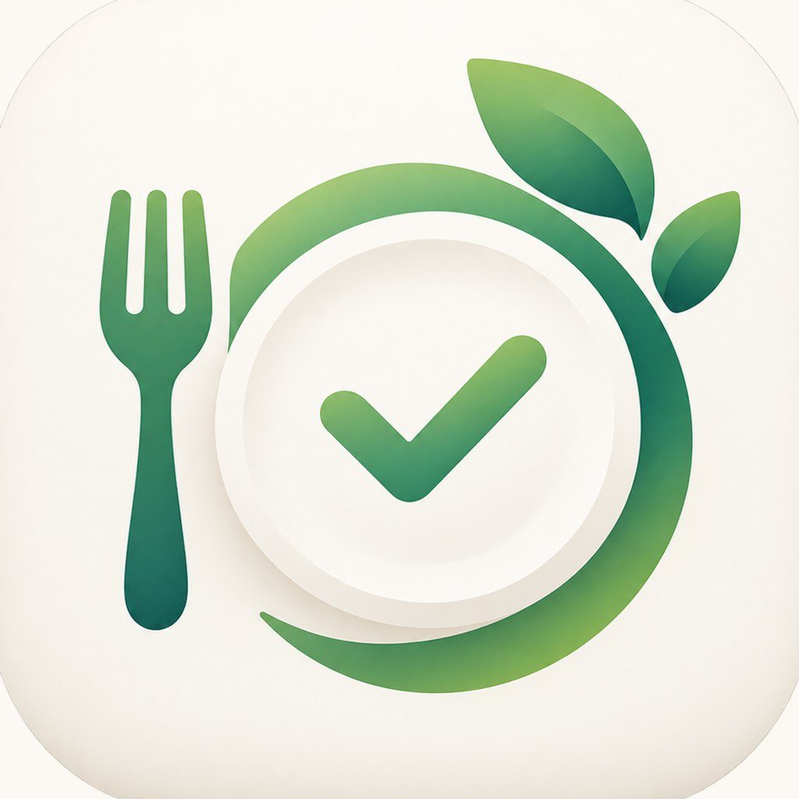

  

<h1 align="center">NutriRoutine</h1>

  <strong>La dieta del tuo nutrizionista, sempre a portata di mano</strong>

  
  
  
  
  
  
  
  
  
  

  <a href="https://apps.apple.com/it/app/nutriroutine/id6817822820"><strong>Disponibile sull'App Store</strong></a>

---

## Descrizione

NutriRoutine è un'app iOS gratuita per **seguire la dieta settimanale che ti ha dato il tuo nutrizionista**: i pasti del giorno con orari, alimenti e quantità, gruppi come "Primo piatto" e alternative ("pollo oppure merluzzo"), con il prossimo pasto sempre in vista sulla schermata di blocco e nella Dynamic Island.

Non crea diete e non dà consigli: organizza e ti ricorda il piano che hai ricevuto da un professionista. Accanto alla dieta gestisce la spesa, la dispensa, l'acqua, il peso con i controlli e la scheda di allenamento.

> NutriRoutine non sostituisce il medico o il nutrizionista. Leggi le [avvertenze mediche e nutrizionali](DISCLAIMER.md).

## Funzionalità

### Dieta
- Inserimento guidato della dieta settimanale, giorno per giorno, con ricerca tra circa 2.000 alimenti italiani: scrivi i grammi o conta le porzioni ("4 fette biscottate", "2 uova", "1 scatoletta"), latte e bevande in millilitri, crudo e cotto; se un alimento non c'è lo inserisci tu, con i valori dell'etichetta o copiati da un alimento simile
- **Gruppi di alimenti** come sul foglio del nutrizionista ("Primo piatto": pasta, pomodoro, parmigiano) con il totale di riferimento, e **alternative** ("pollo oppure merluzzo") da scegliere il giorno stesso in Oggi o nel dettaglio: totali e spesa seguono la scelta
- **Spuntino pre-nanna**, se la dieta lo prevede
- Copia da ieri o su tutti i giorni
- Modifica della dieta su una copia: le modifiche entrano in uso solo con **Salva**, oppure si scartano con **Annulla modifiche**
- **Valori nutrizionali CREA 2019** (Tabelle di composizione degli alimenti, CREA Alimenti e Nutrizione) per circa 590 alimenti, USDA FoodData Central per gli altri
- Oggi: il pasto imminente con conto alla rovescia, pulsante **Mangiato** (annullabile), sostituzioni secondo le regole del nutrizionista (dell'intero pasto o di un singolo alimento, con i limiti settimanali), sgarri
- Vista Settimana e Giorno, pasti da registrare, dettaglio di ogni pasto
- **Scambio di due giorni** della settimana in corso, quando il nutrizionista ti dice di invertirli: menu, orari e promemoria seguono lo scambio solo per quella settimana
- **Valori nutrizionali** indicativi della giornata e di ogni pasto (kcal, proteine, carboidrati, grassi), con le fonti
- **Gestione diete**: dieta attiva con riepilogo, archivio con "Usa di nuovo", export e import in file `.nutriroutine`

### Live Activity, widget e notifiche
- **Live Activity** del prossimo pasto su schermata di blocco e Dynamic Island, con "Mangiato" e "+1 bicchiere" senza aprire l'app
- Widget per la Home e la schermata di blocco
- Promemoria dei pasti con azioni rapide: Mangiato, Posticipa, Aggiungi i mancanti alla spesa
- Comandi Siri e Comandi Rapidi

### Spesa e dispensa
- **Prepara la spesa** per oggi, domani, tre giorni o la settimana: spunti quello che hai già e confermi, il resto entra in lista con il giorno e il pasto in cui serve; scatolette e vasetti entrano **a confezioni**, con i grammi
- Le voci dei pasti già passati escono da sole; un alimento già in lista si vede come "in lista"
- Lista per giorno o per reparto, condivisione, promemoria per andare a fare la spesa
- **Dispensa come magazzino**: le quantità comprate si sommano, quelle mangiate si scalano, "sta finendo" quando la scorta cala; le voci aggiunte a mano si eliminano quando vuoi

### Codice a barre e "la tua marca"
- Scansione del codice a barre in Spesa e Dispensa: il prodotto viene cercato su [Open Food Facts](https://world.openfoodfacts.org) e ne vedi i valori in etichetta
- Usa un prodotto come **la tua marca** al posto dell'alimento generico della dieta: i totali usano i suoi valori
- Se il prodotto non c'è, puoi inserire l'etichetta a mano e, se vuoi, **condividerla con Open Food Facts** (facoltativo, con il tuo consenso)

### Bevi
- Obiettivo giornaliero, bicchieri con un tocco, promemoria intelligenti nella fascia oraria scelta

### Peso e controlli
- Peso di partenza, attuale e variazione, grafico dell'andamento
- Registro dei controlli con il nutrizionista, promemoria il giorno prima
- Pesate e controlli correggibili in qualsiasi momento

### Allenamento
- Schede con esercizi a ripetizioni o a tempo, serie, recuperi, carico e note
- **Schede a circuito** con i giri e il recupero tra un giro e l'altro
- Esecuzione a tutto schermo con timer grande, "Preparati" con il 3-2-1, bip negli ultimi secondi del recupero, suoni di inizio e fine (mai con il silenzioso), "Poi: …" per sapere cosa viene dopo
- **Integratori** indicati dal nutrizionista nella scheda, con promemoria prima, dopo o a un orario
- **"Bevi un sorso"** durante il recupero e Live Activity dell'allenamento

### Sempre
- **Come funziona**: una guida con le schermate dell'app, al primo avvio e in Tu
- Nessun account, nessuna pubblicità, nessun tracciamento: i tuoi dati restano sul dispositivo e nel tuo iCloud privato
- Backup completo in un file per passare a un altro iPhone
- Italiano e inglese, VoiceOver, Dynamic Type, modalità chiara e scura, iPhone e iPad

## Novità

**1.3** (21 ottobre 2026): gruppi di alimenti e alternative nella dieta, spuntino pre-nanna, quantità scrivibile e porzioni nel wizard, spesa a confezioni, integratori e suoni nell'allenamento, tante rifiniture dalla revisione di primo utilizzo.
**1.0** (17 ottobre 2026): prima versione.

## Privacy

I dati della dieta, del peso, dell'acqua e degli allenamenti restano sul tuo dispositivo e, se attivi la sincronizzazione, nel tuo iCloud privato: lo sviluppatore non vi ha accesso.

Quando scansioni un prodotto, l'app chiede a Open Food Facts i dati di quel codice a barre (la richiesta contiene il codice e, come ogni connessione, l'indirizzo IP del dispositivo). Solo se scegli di condividere un prodotto, nome, marca, valori e foto dell'etichetta vengono pubblicati su Open Food Facts con l'account dell'app, senza il tuo nome. La [Privacy Policy](PRIVACY.md) completa ([English](PRIVACY.en.md)) è in questo repository.

## Fonti dei dati

- CREA Alimenti e Nutrizione, *Tabelle di composizione degli alimenti*, revisione 2019
- USDA FoodData Central (pubblico dominio, CC0)
- Open Food Facts, dati dei prodotti sotto licenza ODbL

## English

NutriRoutine is a free iOS and iPadOS app to follow the weekly diet your nutritionist gave you: meals and times, food groups and alternatives, the next meal on the Lock Screen and in the Dynamic Island, groceries by package and pantry, water, weight and check-ups, workouts with supplements. [Download on the App Store](https://apps.apple.com/it/app/nutriroutine/id6817822820). It doesn't create diets or give advice. No account, no ads, no tracking. Privacy Policy: [PRIVACY.en.md](PRIVACY.en.md).

## Contatti

Per supporto, segnalazioni o suggerimenti: [Issues](https://github.com/dindonio/nutriroutine-release/issues)

---

  <em>NutriRoutine, by Antonio Scognamiglio. © 2026</em>

